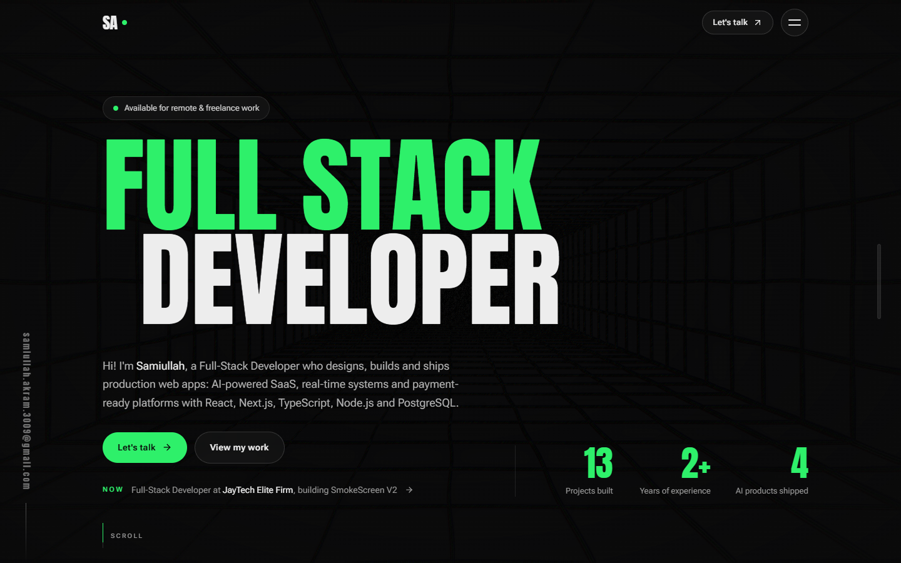

<div align="center">

# 🧑‍💻 Samiullah Akram — Full-Stack Developer Portfolio

**A fast, animated portfolio built with React 19, GSAP, Lenis and Tailwind CSS v4.** It showcases AI-powered SaaS products, real-time systems, payment-ready platforms and my professional experience.

[](https://samiullah-portfolio-orpin.vercel.app/)
[](https://react.dev)
[](https://tailwindcss.com)
[](https://gsap.com)

</div>

---

## 📸 Preview



---

## ✨ Features

- 🧊 **Glass cursor** — a frosted "liquid glass" lens that trails the mouse, stretches with speed, grows over links and shows a *View* label over projects (mouse devices only; touch keeps native behaviour)
- 🎬 **Page transitions** — a two-layer curtain that names the page you're going to, on every route change
- 🧈 **Buttery smooth scrolling** — one Lenis instance driven by the GSAP ticker, synced with ScrollTrigger
- ✍️ **Text reveals** — SplitText character / line reveals on headings, a word-by-word highlight on the About statement
- 🖼️ **Cursor-following previews** — hover a project or job to see its screenshot float beside the cursor; phones get inline thumbnails instead
- 🗂️ **Stacked screenshot galleries** — sticky cards that scale back as the next one slides over
- 🎬 **Intro on every visit** — the name draws in and fills green while a counter loads, on every open and refresh (a click or key press fast-forwards it)
- 🌐 **Grid background** — an interactive WebGL grid in ~200 lines of plain WebGL (no three.js), ~30 fps on touch devices, paused in background tabs
- 🔙 **Scroll restoration** — Back returns you to exactly where you were
- ♿ **Accessible** — skip link, keyboard-friendly menu (Esc to close), visible focus rings, and an **Animations on/off** switch in the menu and footer (visitors whose device asks for reduced motion are offered it once)
- 📱 **Responsive** — tested from 320 px phones to 1920 px desktops
- 🔎 **SEO ready** — meta description, Open Graph / Twitter cards, JSON-LD and per-page titles

---

## 🗂️ Project Structure

```text
src/
├── data/                    # ✏️ All site content lives here — edit text without touching components
│   ├── site.js              # Name, email, socials, nav links
│   ├── projects.js          # Every project (detail pages are generated from this)
│   ├── experience.js        # Work experience (JayTech, Qwetrum, Decode Labs)
│   ├── skills.js            # "My Stack" categories and logos
│   └── education.js         # Degree, certifications, open source
│
├── sections/                # Home page sections: Hero, About, Stack, Experience, Projects, Education, Contact
├── pages/                   # HomePage, AllProjects, DetailPage (projects + experience), NotFound
├── layout/RootLayout.jsx    # Navbar, page transitions, scroll restoration, footer
├── components/              # Navbar, GlassCursor, Preloader, HoverList, StackGallery, buttons…
│   └── background/GridBackground.jsx
├── hooks/                   # useLenis (smooth scroll), useReveal (scroll animations), …
├── assets/images/           # Optimised WebP screenshots
└── logo/                    # Tech logos + LogoLoop marquee
```

### Adding a project

1. Drop a screenshot (WebP or PNG) into `src/assets/images/projects/`.
2. Add an entry to the `projects` array in `src/data/projects.js` (copy an existing one).
3. Set `featured: true` to also show it under **Selected Projects** on the home page.

The page at `/<slug>` and its links are created automatically.

---

## 🏁 Getting Started

```bash
git clone https://github.com/Samiullah-2004/portfolio.git
cd portfolio
npm install
npm run dev        # http://localhost:5173
```

```bash
npm run build      # production build → dist/
npm run preview    # preview the production build
npm run lint       # ESLint
```

Deployed on **Vercel** (`vercel.json` rewrites every route to the SPA).

---

## 📦 Featured Work

### 🎥 SmokeScreen — Live AI video SaaS *(client project, JayTech Elite Firm)*
A creator turns on their webcam, picks a scene, and an AI model transforms them live; the output goes through OBS into WhatsApp, Telegram, Zoom and Meet. I designed and built most of V2: the design system and 35+ page frontend, the Express + Supabase backend, Flutterwave/Squad payments with signed webhooks and per-second credit billing, Gemini / fal.ai / MiniMax creative tools, the admin panel, Jest + Supertest tests on GitHub Actions, and deployment to Railway and Hostinger.
**Stack:** JavaScript · Node.js · Express · Supabase (PostgreSQL, RLS) · Flutterwave · Squad · Gemini · fal.ai · MiniMax · Jest · Railway · Hostinger

### 🤖 ChatSpark AI — RAG chatbot SaaS
Upload documents, create a chatbot trained on them and embed it anywhere with one script tag. Full RAG pipeline: PDF extraction, chunking, Hugging Face embeddings, pgvector search and Groq (Llama 3.3) answers, with multi-tenant isolation and NextAuth.js v5.
**Stack:** Next.js · TypeScript · PostgreSQL · Prisma · pgvector · Hugging Face · Groq · NextAuth.js · Vercel

### 💻 CodeMeet AI — Real-time interview platform
Peer-to-peer WebRTC video, a live shared Monaco editor, chat, Gemini code review and client-side call recording.
**Stack:** Next.js · TypeScript · WebRTC · Socket.IO · DynamoDB · AWS EC2 · NextAuth.js · Gemini

### 🍕 Comptoir — Restaurant ordering platform
Live GraphQL menu, Stripe checkout, Socket.IO order tracking and an admin dashboard with Recharts analytics. Docker, Kubernetes, Vitest/Supertest/Playwright tests and GitHub Actions CI/CD.
**Stack:** React · TypeScript · Apollo GraphQL · Express · PostgreSQL · Prisma · Stripe · Socket.IO · Docker

### 🧾 BillMate · 📝 ResumeForge AI · 🛍️ Stowe · ♟️ OnyxChess · 📍 LivePin · 🎬 Movie Browser · 📋 Paste App · 📈 Crypto Tracker · 🌤️ Skycast
Invoicing SaaS (Express + Prisma), AI resume tailoring (Next.js + Groq), an Express + MongoDB e-commerce store, real-time chess and location tracking (Socket.IO), a TMDB movie browser, a Redux paste manager, a CoinGecko crypto dashboard and an Open-Meteo weather app. Every project has its own page on the site.

---

## 👤 Author

**Samiullah Akram** — Full-Stack Developer · Lahore, Pakistan 🇵🇰

[](https://github.com/Samiullah-2004)
[](https://www.linkedin.com/in/samiullah-akram-a28461404/)
[](https://www.upwork.com/freelancers/~01ffa5cf678d8eff63)
[](mailto:samiullah.akram.3009@gmail.com)

---

## 📄 License

Open source and free to use for personal and educational purposes. If you use it as a reference, a credit is appreciated! 🙏

<div align="center">

**Built with 💚 by Samiullah — 2026**

</div>
